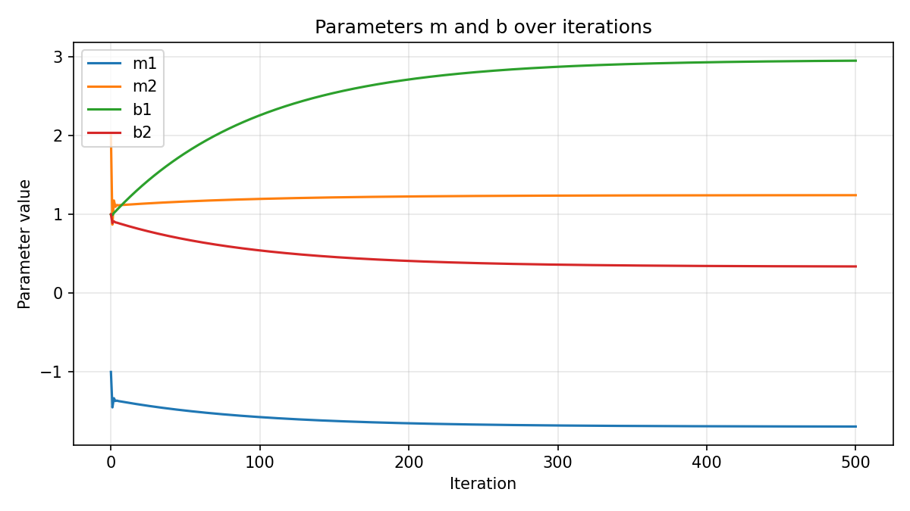
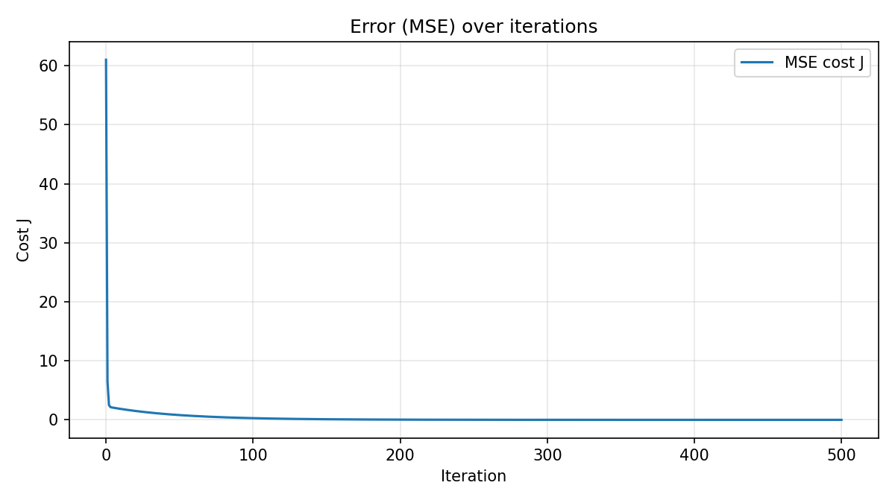

# Formative 3: Probability Distributions, Bayesian Probability and Gradient Descent

Mathematics for Machine Learning, African Leadership University. **Group 13.**

| Member | GitHub | Part |
|---|---|---|
| Alieu O Jobe | [@Jobealieu](https://github.com/Jobealieu) | Part 1: EM algorithm; root README and combined notebook |
| Igor Ntwali | [@igorntwari](https://github.com/igorntwari) | Part 2: Bayesian probability; Part 4: gradient descent in code |
| Gatete Derrick | [@nshutiderrick](https://github.com/nshutiderrick) | Part 3: manual gradient descent calculations |

## Repository

| Path | What it is |
|---|---|
| [`formative3_all_parts.ipynb`](formative3_all_parts.ipynb) | **One notebook running all four parts** through the tested modules below |
| [`part1_em_algorithm/`](part1_em_algorithm/) | EM from scratch (`em_gmm.py`), 13 pytest checks, detailed notebook, Galton data |
| [`part2_bayesian/`](part2_bayesian/) | Bayes' theorem in basic Python (`bayes_imdb.py`), notebook with keyword reasons |
| [`part3_Gradient_Descent_Manual_Calculation/`](part3_Gradient_Descent_Manual_Calculation/) | Handwritten calculations (PDF) and page images |
| [`part4_gradient_descent/`](part4_gradient_descent/) | Gradient descent (`gradient_descent.py`), SciPy derivative, plots (`plots.py`), notebook |

## Run it

```bash
python3 -m venv .venv && source .venv/bin/activate
pip install -r requirements.txt
cd part1_em_algorithm && python -m pytest -q && cd ..   # 13 passed
jupyter notebook formative3_all_parts.ipynb
```

Part 2 needs the 50,000 review IMDb dataset (66 MB, not committed): download `IMDB Dataset.csv` from
[Kaggle](https://www.kaggle.com/datasets/lakshmi25npathi/imdb-dataset-of-50k-movie-reviews) into `part2_bayesian/`.
Every notebook also runs on Google Colab (it clones this repo on its own).

---

## Part 1: EM algorithm on Galton heights

934 children and 205 fathers (one per family), labels hidden, modelled as a mixture of two Gaussians.
EM is written from scratch in NumPy. Initialization (iteration 0) is the global mean split.

| Iteration | μ1 (Children) | μ2 (Fathers) | σ1² | σ2² | π1 | π2 | Log Likelihood |
|---|---|---|---|---|---|---|---|
| 0 (Initialization) | 64.2598 | 70.2147 | 4.1428 | 3.5711 | 0.5048 | 0.4952 | −3071.1165 |
| 1 | 64.3784 | 70.0758 | 4.9168 | 4.2979 | 0.5033 | 0.4967 | −3053.5777 |
| 2 | 64.4368 | 69.9988 | 5.3058 | 4.6724 | 0.5017 | 0.4983 | −3049.7088 |
| 309 (converged) | 64.1772 | 69.5186 | 5.3024 | 6.0410 | 0.4325 | 0.5675 | −3046.9895 |

**Should you split at the global mean and average each pile? No.** It ignores overlap, biases the means outward and
shrinks the variances, fixes the mixing weights by the cut, and gives no probabilities. EM gives soft assignments and
stops when the log likelihood improves by less than 10⁻⁶. Decision boundary: **66.54 in**.

**Key finding:** EM separates daughters (64.2) from sons and fathers (69.5), because the children are both sexes.
On fathers vs daughters only, EM beats the mean split (86% vs 81% accuracy). Details: [Part 1 README](part1_em_algorithm/README.md).


## Part 2: Bayesian probability on IMDb reviews

We compute **P(Positive | keyword)** only, with basic Python (`csv`, `re`), counting each keyword once per review.

| Keyword | Prior P(Positive) | Likelihood P(kw \| Positive) | Marginal P(kw) | Posterior P(Positive \| kw) |
|---|---|---|---|---|
| excellent | 0.5000 | 0.1146 | 0.0710 | 0.8073 |
| wonderful | 0.5000 | 0.0902 | 0.0555 | 0.8120 |
| superb | 0.5000 | 0.0410 | 0.0240 | 0.8557 |
| amazing | 0.5000 | 0.0671 | 0.0431 | 0.7783 |
| worst | 0.5000 | 0.0164 | 0.0886 | 0.0924 |
| awful | 0.5000 | 0.0112 | 0.0575 | 0.0977 |
| terrible | 0.5000 | 0.0152 | 0.0539 | 0.1413 |
| waste | 0.5000 | 0.0070 | 0.0507 | 0.0687 |

Every posterior is verified against a direct count. Keyword reasons: [Part 2 notebook](part2_bayesian/part2_bayes.ipynb).

## Part 3: Gradient descent by hand

ŷ = Xm + b with X = [[1, 3], [4, 10]], m₀ = [−1, 2], b₀ = [1, 1], y = [5, 6], α = 0.01, J = (1/n) eᵀe.
Chain rule: ∂J/∂m = (∂J/∂e)(∂e/∂m) = (2/n) Xᵀe and ∂J/∂b = (∂J/∂e)(∂e/∂b) = (2/n) e.

| After update | m | b | Cost J |
|---|---|---|---|
| 0 (start) | [−1, 2] | [1, 1] | 61 |
| 1 | [−1.45, 0.87] | [0.99, 0.89] | 6.5033 |
| 2 | [−1.3331, 1.1765] | [1.0185, 0.9121] | 2.4974 |
| 3 | [−1.369037, 1.095583] | [1.036351, 0.898653] | 2.1645 |

**Trend:** the cost falls at every update, so m and b move in a direction that reduces the error. The first step is
large because the starting error is large; afterwards m₂ and b swing back slightly because α = 0.01 is close to the
stability limit (about 0.0158 for this data). Handwritten work: [PDF](part3_Gradient_Descent_Manual_Calculation/part%203%20Gradient%20Descent%20Manual%20Calculation.pdf).

## Part 4: Gradient descent in code

The Part 3 updates in Python, every intermediate value printed and identical to the handwritten results. The gradient is
computed by the chain rule and by a SciPy derivative function (`derivative_of`), which agree. After 500 iterations the
cost drops from 61 to 0.00007.

| m and b over iterations | Error over iterations |
|---|---|
|  |  |

## Contributions

Task allocation, completion status and meeting log: [contributions.pdf](contributions.pdf)
