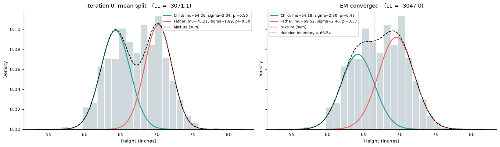
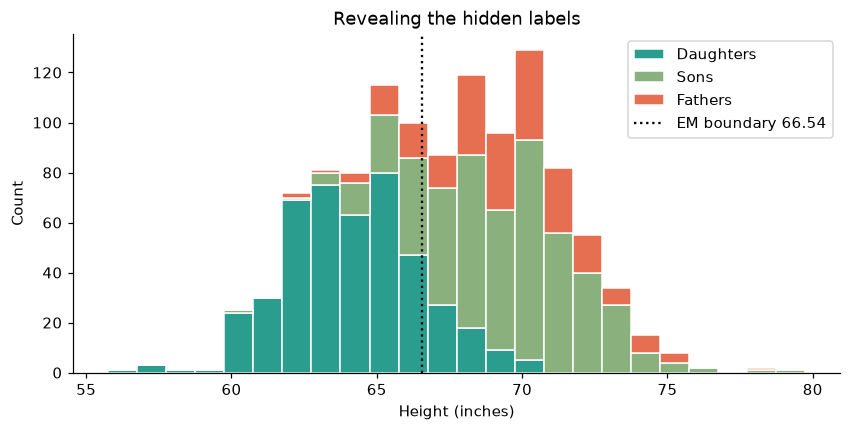

# Part 1: Probability Distributions, the EM Algorithm

Owner: Alieu O Jobe ([@Jobealieu](https://github.com/Jobealieu))

We pool **fathers' and children's heights** from the Galton Families dataset (1886), hide who is who,
and fit a mixture of two Gaussians with **Expectation Maximization written from scratch** (NumPy only).

| File | What it is |
|---|---|
| `part1_em_algorithm.ipynb` | The presentation notebook: data, mean split, EM maths, tracking table, live demo, validation |
| `em_gmm.py` | EM implementation (E step, M step, log likelihood, posterior, tracking table) |
| `test_em_gmm.py` | 13 pytest checks (parameter recovery, monotone log likelihood, input validation, de duplication) |
| `data/GaltonFamilies.csv` | 934 children, 205 families (one row per child) |
| `figures/` | Plots embedded in the notebook |

## Run it

```bash
cd part1_em_algorithm
python3 -m venv .venv && source .venv/bin/activate
pip install -r requirements.txt
python -m pytest -q
jupyter notebook part1_em_algorithm.ipynb
```

Tested with Python 3.12, NumPy 2.4, pandas 3.0, Matplotlib 3.10.

## Tracking table (fathers + children, N = 1139)

Initialization (iteration 0) is the global mean split, so row 0 *is* the naive method.

| Iteration | μ1 (Children) | μ2 (Fathers) | σ1² | σ2² | π1 | π2 | Log Likelihood |
|---|---|---|---|---|---|---|---|
| 0 (Initialization) | 64.2598 | 70.2147 | 4.1428 | 3.5711 | 0.5048 | 0.4952 | −3071.1165 |
| 1 | 64.3784 | 70.0758 | 4.9168 | 4.2979 | 0.5033 | 0.4967 | −3053.5777 |
| 2 | 64.4368 | 69.9988 | 5.3058 | 4.6724 | 0.5017 | 0.4983 | −3049.7088 |
| 309 (converged) | 64.1772 | 69.5186 | 5.3024 | 6.0410 | 0.4325 | 0.5675 | −3046.9895 |

Stopping rule: log likelihood improves by less than 10⁻⁶. Decision boundary (P = 0.5): **66.54 in**.



## Should you split at the global mean and average each pile?

**No** (it is only a reasonable starting point):

1. It assumes the groups do not overlap, so every height in the overlap is misclassified with full confidence.
2. Truncation bias: the low pile's mean is pushed down, the high pile's up, and both variances shrink.
3. The mixing weights come from the cut (about 50/50), not from the data.
4. It gives hard labels, no probabilities. EM gives soft assignments and a log likelihood to optimise.

On fathers vs daughters (where the truth is known) the mean split estimates the daughters' variance as 2.94 against a true 5.54;
EM gets 4.75, and accuracy rises from 81% to 86%.

## Key finding

EM converged to 64.2 in and 69.5 in. Revealing the labels shows these are **daughters** vs **sons plus fathers**:
the children are both sexes, sons are as tall as fathers (69.2 vs 69.3), so the dominant structure is sex, not generation.
EM maximised the likelihood correctly; the "Children / Fathers" names on the components do not hold.


